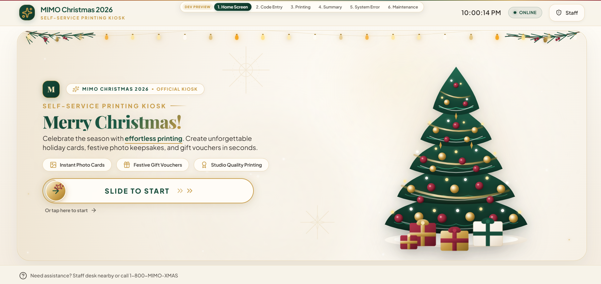
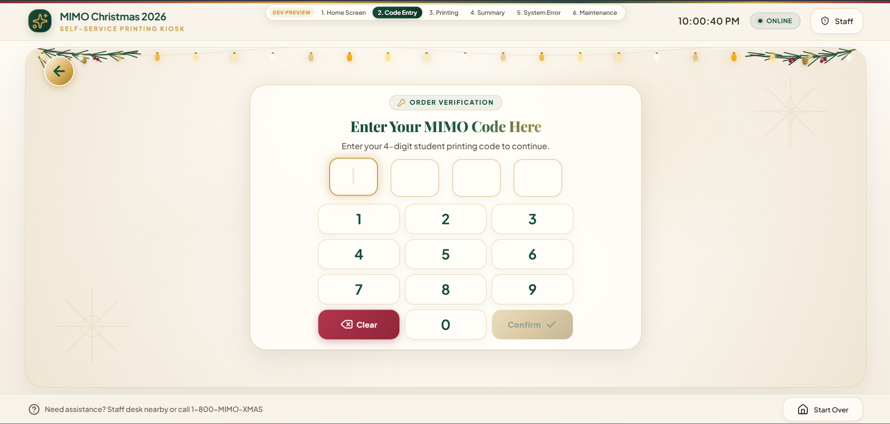
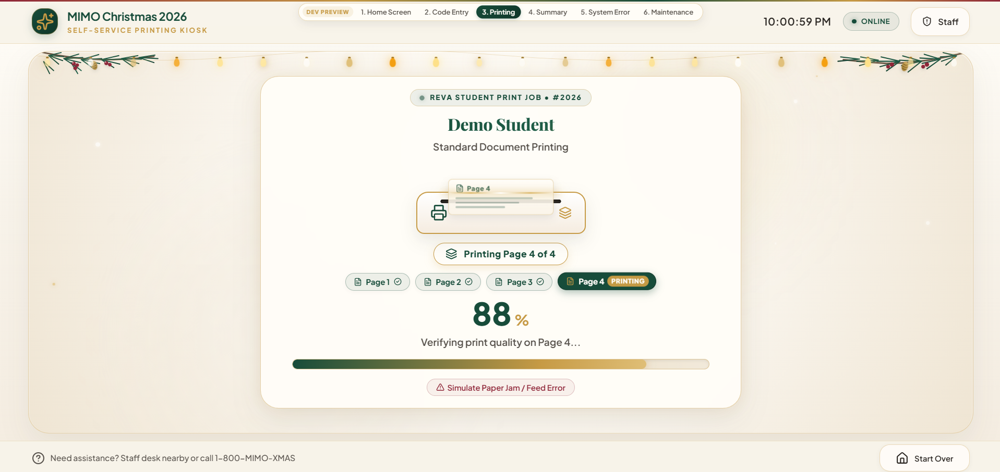
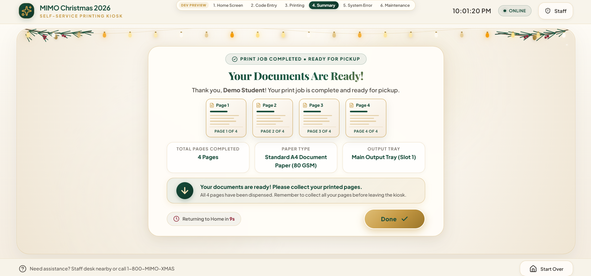
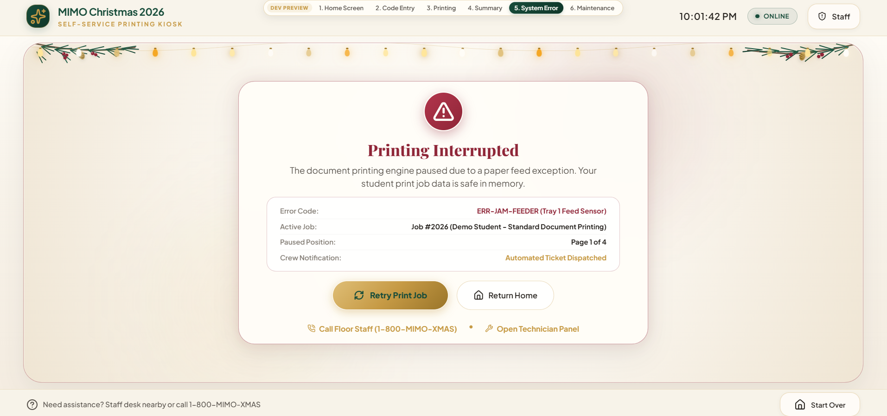
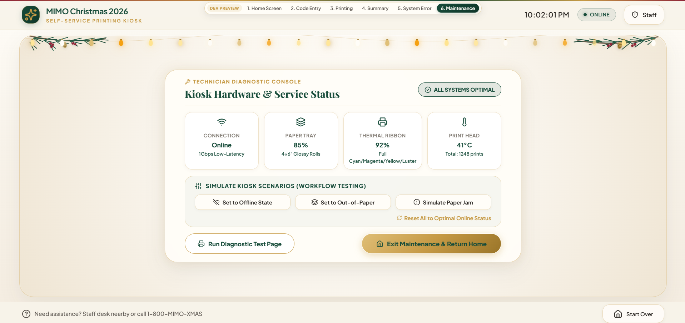

# MIMO Christmas 2026 – Self-Service Printing Kiosk


A frontend-only, self-service printing kiosk web application built with **React 19**, **Vite 6**, and custom CSS design tokens. Optimized for a 1920 × 1080 landscape touchscreen display, the application features an elegant **Luxury Warm Ivory & Champagne Gold** Christmas theme with Deep Evergreen accents.

The project models a complete commercial student printing workflow—from an interactive welcome screen and automated passcode verification to realistic laser printing simulation, paper jam error recovery, and a technician hardware maintenance console.

---

## Table of Contents

- [Screenshots](#screenshots)
- [Key Features](#key-features)
- [Architecture and Screen Navigation Flow](#architecture-and-screen-navigation-flow)
- [Demo Codes and Testing](#demo-codes-and-testing)
- [User Interaction & Controls](#user-interaction--controls)
- [Technology Stack](#technology-stack)
- [Project Folder Structure](#project-folder-structure)
- [Installation and Execution](#installation-and-execution)
- [Important Project Notes](#important-project-notes)
- [Future Improvements](#future-improvements)

---

## Screenshots

### 1. Home Screen
Welcome interface featuring luxury branding, animated Christmas tree, glowing fairy lights garland, snowfall particle canvas, and interactive Slide-to-Start control.


### 2. Code Entry Screen
Touchscreen 3×4 numeric keypad and 4-digit code entry with automatic validation and submission upon entering the fourth digit.


### 3. Printing Screen
Progressive laser printing simulation featuring an emerging document sheet animation, dynamic page counter, and document page status queue.


### 4. Summary Screen
Document pickup summary displaying individual page previews (`Page 1`, `Page 2`, `Page 3`, `Page 4`), job metrics, collection guidance, and a 10-second automatic return countdown.


### 5. System Error Screen
Hardware exception alert (simulated paper feed jam) displaying diagnostic metadata, floor staff notification trigger, and a working Retry Print Job button.


### 6. Maintenance Screen
Technician diagnostic console equipped with live status gauges, fault simulation switches, master reset, and a 5-stage diagnostic test page print cycle.


---

## Key Features

### 1. Home Screen (`HomeScreen`)
- **Festive Luxury Visuals**: Warm Ivory (`#F8F3EA`) background with Champagne Gold (`#C69A45`) borders, pine corner accents, glowing fairy lights, and an animated particle snowfall canvas.
- **Layered Vector Tree**: Detailed vector Christmas tree illustration with glowing fairy lights, ornaments, and holiday gift boxes.
- **Slide-to-Start Interaction**: Touch-draggable and mouse-draggable slider with track-tap fallback to smoothly begin the kiosk workflow.

### 2. Code Entry Screen (`CodeEntryScreen`)
- **Automatic Four-Digit Submission**: Automatically validates and submits as soon as the fourth digit is entered—no manual click on Confirm required.
- **Virtual Touchscreen Keypad**: High-contrast 3×4 numeric layout with dedicated Backspace and accessible Confirm buttons.
- **Input Feedback**: Four individual digit boxes with pop animations, cursor highlight, and a shake error animation on invalid inputs.

### 3. Printing Screen (`PrintingScreen`)
- **Laser Spooler Visual**: Emerging document sheet animation with an oscillating laser scanning beam.
- **Real-Time Indicators**: Live status descriptions, dynamic page counter badge (`Printing Page X of Y`), and document page queue chips (`Page 1` through `Page 4`).
- **Progress Tracking**: Smooth 0% $\rightarrow$ 100% progress hero counter with automatic transition to the Summary screen upon completion.

### 4. Summary Screen (`SummaryScreen`)
- **Document Previews**: Renders page-by-page mockup cards labeled `Page 1`, `Page 2`, `Page 3`, and `Page 4`.
- **Job Metrics**: Displays total pages completed, paper type (`Standard A4 Document Paper 80 GSM`), and illuminated collection slot.
- **Collection Guidance & Auto-Return**: Illuminated tray guidance box with an automatic 10-second countdown timer returning to Home, plus a manual "Done" override button.

### 5. System Error Screen (`SystemErrorScreen`)
- **Realistic Paper Jam Exception**: Displays hardware alert `ERR-JAM-FEEDER` when triggered (e.g., via demo code `9999` at 45% progress or manual simulation button).
- **Interactive Recovery**: Working **Retry Print Job** action that clears error states, resets page counters, and resumes simulated printing.
- **Staff Escalation**: Attendant notification alert dispatch simulation and direct shortcut into the technician maintenance panel.

### 6. Technician Maintenance Dashboard (`MaintenanceScreen`)
- **Diagnostic Gauges**: Four real-time monitoring cards for Network Connection, Paper Tray capacity, Thermal Ribbon level, and Print Head temperature.
- **Fault Injection Switches**: Interactive toggle buttons to simulate Offline state, Out-of-Paper error, and Paper Jam conditions.
- **Five-Stage Diagnostic Self-Test**: Automated printer test with a visible progress bar (0% $\rightarrow$ 100%) stepping through five discrete phases:
  1. *Initializing printer* (0% – 19%)
  2. *Checking paper tray* (20% – 39%)
  3. *Checking thermal ribbon* (40% – 59%)
  4. *Testing print head* (60% – 79%)
  5. *Printing diagnostic page* (80% – 99%)
- **Confirmation & Rerun**: Green checkmark banner (`Diagnostic Test Completed Successfully!`), automatic lifetime print counter incrementation, and a re-run option.

---

## Architecture and Screen Navigation Flow

The application is structured around a centralized state machine in `App.jsx`, orchestrating screen navigation, print job state, and hardware diagnostic statuses.

```
                  ┌───────────────────────┐
                  │ Screen 1: Home Screen │
                  └──────────┬────────────┘
                             │ (Slide to Start / Tap)
                             ▼
               ┌───────────────────────────┐
               │ Screen 2: Code Entry      │
               └─────────────┬─────────────┘
                             │ (Auto 4-Digit Submit)
                             ▼
               ┌───────────────────────────┐
               │ Screen 3: Printing Screen │◄─────────────────┐
               └──────┬─────────────┬──────┘                  │
      (Code 9999 / Jam│             │ (Normal Completion)     │ (Retry Print Job)
      at 45% progress)│             ▼                         │
                      │ ┌─────────────────────────┐           │
                      │ │ Screen 4: Summary Screen│           │
                      │ └───────────┬─────────────┘           │
                      │             │ (Done / 10s Countdown)  │
                      │             ▼                         │
                      │ ┌─────────────────────────┐           │
                      │ │ Screen 1: Home Screen   │           │
                      │ └─────────────────────────┘           │
                      ▼                                       │
       ┌───────────────────────────────┐                      │
       │ Screen 5: System Error Screen ├──────────────────────┘
       └──────────────┬────────────────┘
                      │ (Open Technician Panel)
                      ▼
       ┌───────────────────────────────┐
       │ Screen 6: Maintenance Screen  │
       └───────────────────────────────┘
```

> **Note**: Screen 6 (Maintenance) is also accessible from any screen via the **Staff** button located in the top kiosk header.

---

## Demo Codes and Testing

Pre-configured print jobs in `src/utils/constants.js` allow comprehensive testing of all workflows:

| Code | Profile / Description | Total Pages | Behavior / Workflow |
| :---: | :--- | :---: | :--- |
| **`2026`** | Demo Student – Standard Document Printing | 4 Pages | Smooth 0% $\rightarrow$ 100% printing $\rightarrow$ Summary Screen |
| **`1225`** | Demo Student – Standard Document Printing | 3 Pages | Smooth 0% $\rightarrow$ 100% printing $\rightarrow$ Summary Screen |
| **`7842`** | Demo Student – Standard Document Printing | 4 Pages | Smooth 0% $\rightarrow$ 100% printing $\rightarrow$ Summary Screen |
| **`9999`** | Demo Student – Simulated Error Test | 4 Pages | **Paper Jam at 45%** $\rightarrow$ System Error Screen with working Retry |
| *Any Other* | Demo Student – Standard Document Printing | 4 Pages | Any other 4-digit code (e.g., `0000`, `1111`, `4321`) generates a standard job |

---

## User Interaction & Controls

The kiosk is designed for 1920 × 1080 landscape touchscreens and provides full physical keyboard accessibility:

### Touchscreen Interactions
- **Slide to Start**: Swipe the golden slider thumb across the track on the Home screen (supports touch dragging and mouse dragging, with tap fallback).
- **Virtual Numeric Keypad**: Tap buttons on the on-screen 3×4 numeric keypad.
- **Automatic Code Submission**: Entering the 4th digit automatically submits and navigates to the Printing screen after a brief 120ms visual confirmation.
- **Staff Access**: Tap the "Staff" button in the top header on any screen to open the technician console.

### Physical Keyboard Controls
- **`0` – `9`**: Types digits into the code entry boxes on the Code Entry screen. Automatically submits upon typing the fourth digit.
- **`Backspace`**: Deletes the most recently entered digit (active before the fourth digit is submitted).
- **`Enter`**: Manually submits the code if 4 digits are present.
- **`Escape`**: Cancels code entry and returns to the Home screen.

---

## Technology Stack

| Layer | Technology | Version | Purpose |
| :--- | :--- | :---: | :--- |
| **Framework** | **React** | `19.0.0` | Functional components, state hooks (`useState`, `useEffect`, `useCallback`, `useRef`) |
| **Build Tool** | **Vite** | `6.2.0` | Development server and Rollup production bundling |
| **Language** | **JavaScript (ES6+)** | ES2022+ | Modern JSX application logic |
| **Styling** | **Custom Vanilla CSS** | CSS3 | Scoped screen stylesheets and CSS custom properties (design tokens) |
| **Iconography** | **Lucide React** | `1.16.0` | Scalable vector icons across all kiosk screens |
| **Typography** | **Google Fonts** | — | `Playfair Display` (Luxury serif headings) & `Plus Jakarta Sans` (UI / metrics) |

---

## Project Folder Structure

```
MIMO-Christmas-2026/
├── docs/
│   └── screenshots/
│       ├── 01-home.png                            # Home screen screenshot
│       ├── 02-code-entry.png                      # Code entry screen screenshot
│       ├── 03-printing.png                        # Printing screen screenshot
│       ├── 04-summary.png                         # Summary screen screenshot
│       ├── 05-system-error.png                    # System error screen screenshot
│       └── 06-maintenance.png                     # Maintenance screen screenshot
├── public/
│   └── favicon.svg                                # Festive kiosk SVG icon
├── src/
│   ├── components/
│   │   ├── common/
│   │   │   ├── Footer/
│   │   │   │   └── KioskFooter.jsx                # Kiosk footer with support info & restart
│   │   │   └── Header/
│   │   │       └── KioskHeader.jsx                # Top bar with clock, status badge & staff action
│   │   └── layout/
│   │       └── KioskLayout.jsx                    # 1920×1080 canvas shell and layout wrapper
│   ├── screens/
│   │   ├── CodeEntryScreen/
│   │   │   ├── CodeEntryScreen.css                # Keypad & 4-box input styling
│   │   │   └── CodeEntryScreen.jsx                # Passcode verification with auto-submit
│   │   ├── HomeScreen/
│   │   │   ├── components/
│   │   │   │   ├── ChristmasLights.jsx            # Interactive glowing holiday garland
│   │   │   │   ├── CornerEvergreens.jsx           # Delicate evergreen border accents
│   │   │   │   ├── FestiveTree.jsx                # Layered SVG Christmas tree illustration
│   │   │   │   ├── SlideToStart.jsx               # Touch & mouse drag-to-start slider
│   │   │   │   └── Snowfall.jsx                   # Particle canvas snowfall effect
│   │   │   ├── HomeScreen.css                     # Home screen layout & typography styling
│   │   │   └── HomeScreen.jsx                     # Welcome hero screen
│   │   ├── MaintenanceScreen/
│   │   │   ├── MaintenanceScreen.css              # Diagnostic gauges & progress styling
│   │   │   └── MaintenanceScreen.jsx              # Technician dashboard & 5-stage test print
│   │   ├── PrintingScreen/
│   │   │   ├── PrintingScreen.css                 # Spooler, laser beam & page queue styling
│   │   │   └── PrintingScreen.jsx                 # Progressive printing simulation
│   │   ├── SummaryScreen/
│   │   │   ├── SummaryScreen.css                  # Document mockup stack & timer styling
│   │   │   └── SummaryScreen.jsx                  # Order completion & pickup guidance
│   │   ├── SystemErrorScreen/
│   │   │   ├── SystemErrorScreen.css              # Hardware alert & action styling
│   │   │   └── SystemErrorScreen.jsx              # Paper jam alert & working retry
│   │   └── index.js                               # Barrel export for screen components
│   ├── styles/
│   │   ├── global.css                             # Color tokens, typography & CSS reset
│   │   └── kiosk.css                              # 1920×1080 canvas & tablet media queries
│   ├── utils/
│   │   └── constants.js                           # Job database, screen keys & kiosk config
│   ├── App.jsx                                    # Top-level state manager & dev switcher
│   └── main.jsx                                   # React DOM root entry point
├── .gitignore                                     # Git exclusion rules
├── index.html                                     # HTML template & font preconnections
├── package-lock.json
├── package.json                                   # Scripts & dependencies
├── README.md                                      # Project documentation
└── vite.config.js                                 # Vite configuration
```

---

## Installation and Execution

### Prerequisites
- **Node.js**: `v18.0.0` or higher
- **npm**: `v9.0.0` or higher

### Steps

1. **Clone or navigate to the project repository**:
   ```bash
   cd MIMO-Christmas-2026
   ```

2. **Install project dependencies**:
   ```bash
   npm install
   ```

3. **Start the local development server**:
   ```bash
   npm run dev
   ```

4. **Access the kiosk in your browser**:
   Navigate to `http://localhost:3000` (or the local address indicated by Vite).

### Production Build

To compile and verify the production-ready build:

```bash
# Compile optimized static bundle into /dist
npm run build

# Preview the production build locally
npm run preview
```

---

## Important Project Notes

- **Frontend-Only Demonstration**: This application is a client-side frontend simulation. All printing workflows, laser spooling animations, page counters, paper jam alerts, and hardware sensor readings are simulated within React component state.
- **No Physical Hardware Integration**: There is no connection to physical receipt printers, thermal card printers, or USB/serial printing devices.
- **No Backend, Database, or Authentication**: No server APIs, Firebase services, user databases, or payment gateways are included or required.

---

## Future Improvements

1. **Physical Hardware Driver Integration**: Connect to physical thermal or laser document printers using WebUSB or WebSerial APIs.
2. **Barcode & QR Camera Lookup**: Integrate camera-based scanning via the WebRTC MediaDevices API for fast touchless code entry.
3. **Multi-Language Support**: Implement internationalization (`i18n`) for multi-lingual student campus kiosks.
4. **Haptic & Audio Cues**: Introduce optional subtle audio feedback for touch keypad presses, print job completion, and error alerts.
